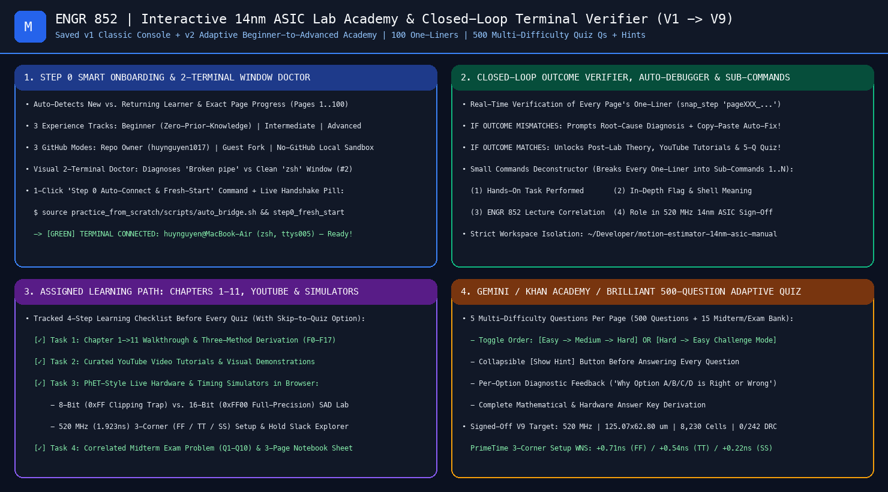

# ENGR 852 Manual From-Scratch Practice Sub-Branch (`manual-practice-macbook-air`)

This sub-branch records the live step-by-step terminal executions, `.log` transcripts, and auto-rendered terminal `.png` screenshots from **`huynguyen@MacBook-Air`** (`~/Developer/motion-estimator-14nm-asic-manual`), **`926784856@mahmoodi.rcc.at.sfsu.edu`** (`~/me_asic_new_v1`), and the **v4.0 Rose & Lavender Interactive ASIC Studio (`:8788`)** as each page of the **100-Page Manual (`Page 1 -> Page 100`, `V1 -> V9`)** is executed and verified.

> **Isolation Guarantee**: Pre-built project directories from `main` are excluded from this practice branch so your main signed-off portfolio (`main`) remains 100% untouched.

## 🌸 Featured Full-Stack Interactive ASIC Studio (`v4.0 Rose & Lavender Edition` on `:8788`)

| Version | Key Capabilities | Snapshot File |
| :--- | :--- | :--- |
| **v4.0 Rose & Lavender Interactive ASIC Studio (Latest)** | Bright, uncluttered **5-Tab Rose-Blush & Lavender Studio** with **Live macOS `Terminal.app` (`/dev/ttys*`) Output Mirroring**, **Automatic `XQuartz.app` GUI Launcher**, **1-Click Self-Healing AI Auto-Debugger** (`/api/ai_fix_page`), **Full 100-Page `V1 → V9` Project Auto-Builder**, **Curated YouTube Video Walkthroughs**, **4 Interactive Hardware & 14nm STA Simulators**, and **500-Question Page Mastery Quiz + 15-Question Midterm Exam (`Q1–Q15`)**. | [`docs/interactive_asic_studio_v4_rose_lavender.html`](docs/interactive_asic_studio_v4_rose_lavender.html) |
| **v3.0 Full-Stack ASIC Web IDE (Archived)** | Split-screen dark Web IDE with embedded terminal and multi-file Verilog/TCL/SDC editor. | [`docs/interactive_asic_ide_v3.html`](docs/interactive_asic_ide_v3.html) |
| **v2.0 Adaptive Beginner-to-Advanced Academy (Archived)** | Step 0 Terminal Window Doctor, Experience Level Switcher (`Beginner / Intermediate / Advanced`), and 4-Task Learning Path. | [`docs/interactive_asic_academy_v2.html`](docs/interactive_asic_academy_v2.html) |
| **v1.0 Classic Live Operations Console (Archived)** | Original 100-Page One-Liner Checklist, Closed-Loop Terminal Verifier, and 3-Method RTL Study Guide (`F0–F17`). | [`docs/interactive_console_v1_classic.html`](docs/interactive_console_v1_classic.html) |
