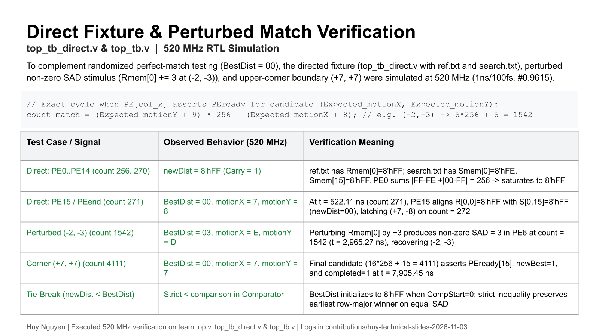
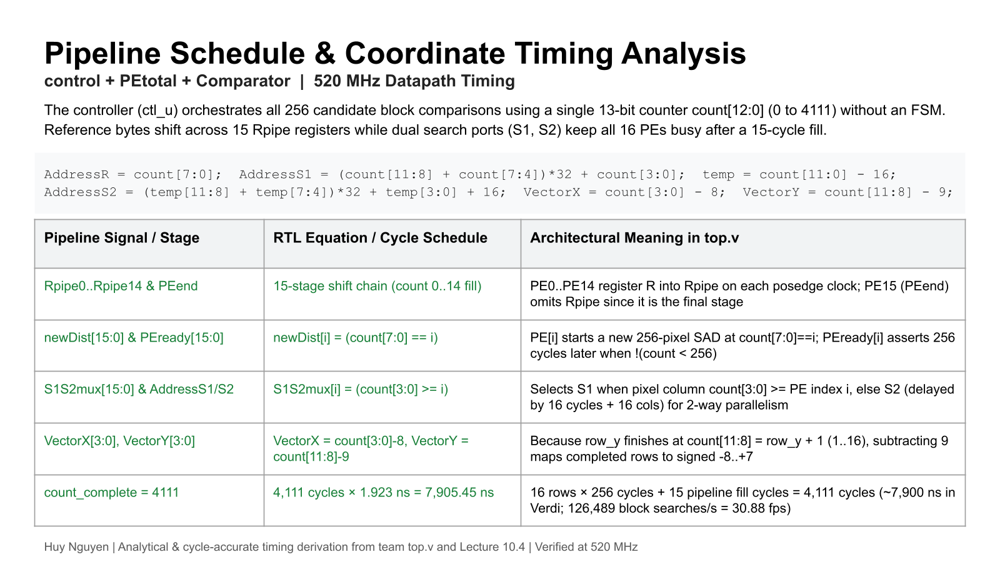
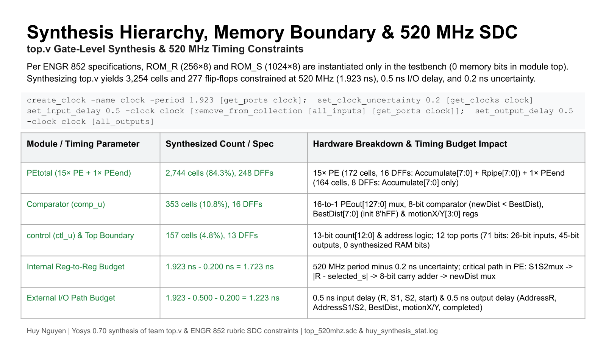
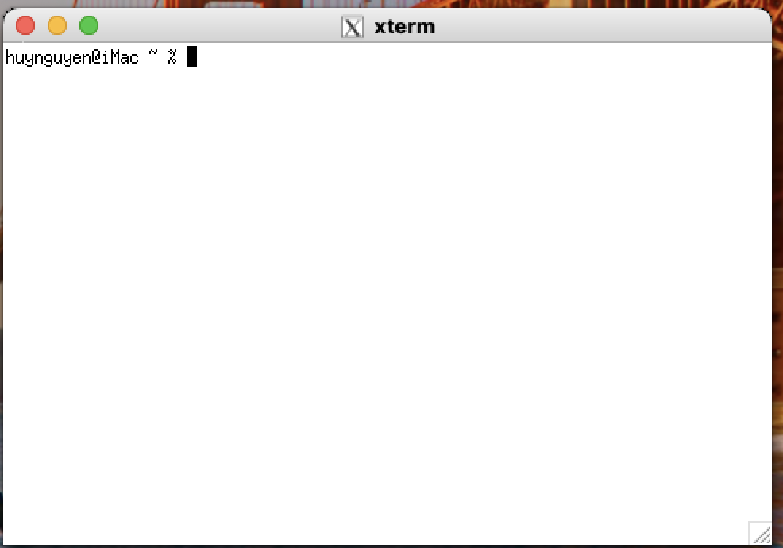

# 520 MHz Motion Estimator ASIC — RTL Verification, Architecture & Lab Portfolio

**Author:** Huy Nguyen  
**Course:** ENGR 852 — Advanced Digital Design (San Francisco State University, Fall 2026)  
**Target Specification:** 520 MHz (`1.923 ns` clock period) · 16×16 Reference Block · 31×31 Search Window · 14 nm CMOS ASIC Flow

---

## Executive Summary

This repository documents the architecture analysis, 520 MHz RTL verification, pipeline timing schedule derivation, synthesis hierarchy characterization, Synopsys Design Constraints (SDC), and laboratory execution log for a hardware **Full-Search Block-Matching Motion Estimator ASIC**.

The hardware engine computes the Sum of Absolute Differences (SAD) between a `16×16` 8-bit grayscale reference macroblock (`R_Ram`, 256 bytes) and all `256` candidate positions (`[-8, +7]` in X and Y) within a `31×31` search window (`S_Ram`, 1,024 bytes). By streaming reference pixels through a 15-stage shift pipeline (`Rpipe0..Rpipe14`) across 16 parallel Processing Elements (`PE0..PE14` and `PEend`) fed by dual search-window read ports (`S1`, `S2`), the architecture completes a full 256-candidate macroblock search in **4,111 clock cycles** (`7,905.45 ns` at `520 MHz`, sustaining **126,489 block searches/sec** or **30.88 fps** at 4,096 macroblocks/frame).

---

## Repository Structure

```text
├── README.md                                          # Portfolio overview, architecture & results summary
├── rtl/
│   └── top.v                                          # Motion Estimator RTL (top, control, PEtotal, PE, PEend, Comparator)
├── tb/
│   ├── huy_verification_520mhz_tb.v                   # 520 MHz directed, perturbed non-zero SAD & corner-case testbench
│   ├── top_tb.v                                       # 520 MHz randomized stimulus testbench
│   ├── top_tb_direct.v                                # 520 MHz directed fixture testbench
│   ├── ref.txt                                        # 256-byte reference block fixture
│   └── search.txt                                     # 1,024-byte search window fixture
├── constraints/
│   └── top_520mhz.sdc                                 # Synopsys Design Constraints (520 MHz, 0.5 ns I/O, 0.2 ns uncertainty)
├── docs/
│   ├── lab-notebook.md                                # Detailed timestamped engineering log (UPDATE-001, UPDATE-002)
│   ├── CURRENT_STATUS.md                              # Current project checkpoint & active server queue
│   ├── UPDATE_PROTOCOL.md                             # Timestamped documentation and evidence integrity standards
│   ├── next-steps.md                                  # Upcoming Synopsys VCS/Verdi, Fusion Compiler & PrimeTime server steps
│   └── evidence-policy.md                             # Provenance, redaction & verification standards
└── evidence/
    ├── manifest.json                                  # SHA-256 cryptographic checksums of all evidence artifacts
    ├── logs/
    │   ├── huy_verification_520mhz.log                # Captured 520 MHz RTL simulation output (Tests 1, 2, and 3)
    │   └── huy_synthesis_stat.log                     # Captured gate-level synthesis cell & flip-flop hierarchy report
    ├── slides/
    │   ├── slide14-direct-perturbed-verification.png  # Technical Slide 1: Direct Fixture & Perturbed Match Verification
    │   ├── slide15-pipeline-schedule-timing.png       # Technical Slide 2: Pipeline Schedule & Coordinate Timing Analysis
    │   └── slide16-synthesis-hierarchy-sdc.png        # Technical Slide 3: Synthesis Hierarchy, Memory Boundary & 520 MHz SDC
    ├── screenshots/
    │   ├── 01-vpn-disconnected.png                    # SFSU GlobalProtect VPN initial state
    │   ├── 02-vpn-connected.png                       # SFSU GlobalProtect VPN authenticated connection
    │   └── 03-local-xterm.png                         # Local XQuartz xterm window for X11 forwarding
    └── transcripts/
        ├── 01-ssh-login.txt                           # Authenticated SSH session transcript to mahmoodi.rcc.at.sfsu.edu
        └── 02-session-status.txt                      # Remote working directory and DISPLAY=localhost:12.0 verification
```

---

## Key Technical Results Completed

### 1. 520 MHz Directed, Perturbed Non-Zero SAD & Boundary RTL Verification
Using [`tb/huy_verification_520mhz_tb.v`](tb/huy_verification_520mhz_tb.v) at the target `520 MHz` clock (`timescale 1ns/100fs`, `always #0.9615 clock = ~clock;`, `T = 1.9230 ns`), three verification scenarios were executed against [`rtl/top.v`](rtl/top.v) (log in [`evidence/logs/huy_verification_520mhz.log`](evidence/logs/huy_verification_520mhz.log)):

| Test Scenario | Candidate Displacement | Match Cycle (`count`) | Simulated Time (`520 MHz`) | Observed Outputs (`BestDist`, `motionX`, `motionY`) | Hardware Verification Outcome |
| :--- | :--- | :--- | :--- | :--- | :--- |
| **Test 1: Direct Fixture (`ref.txt`, `search.txt`)** | `(+7, -8)` | `271` (latched `272`) | `522.1145 ns` (`7,905.4530 ns` full run) | `BestDist = 8'h00`, `motionX = 4'h7 (+7)`, `motionY = 4'h8 (-8)` | Confirms `PE0..PE14` saturate to `8'hFF` (`Carry = 1`, `1+255=256`) while `PE15` (`PEend`) aligns `R[0,0]=8'hFF` with `S[0,15]=8'hFF` |
| **Test 2: Perturbed Non-Zero SAD (`Rmem[0] += 3`)** | `(-2, -3)` | `1542` (`6×256 + 6`) | `2,965.2660 ns` (`7,905.4530 ns` full run) | `BestDist = 8'h03`, `motionX = 4'hE (-2)`, `motionY = 4'hD (-3)` | Verifies non-zero SAD accumulation and exact match-cycle formula `count = (Expected_motionY + 9)*256 + (Expected_motionX + 8)` |
| **Test 3: Upper-Corner Boundary** | `(+7, +7)` | `4111` (`16×256 + 15`) | `7,905.4530 ns` | `BestDist = 8'h00`, `motionX = 4'h7 (+7)`, `motionY = 4'h7 (+7)` | Verifies final candidate evaluation coinciding with `completed = 1` and 4-bit 2's complement wrap (`count[11:8] - 9 = 0 - 9 = 4'd7`) |



---

### 2. Datapath Pipeline Schedule & Coordinate Timing Analysis
The controller (`ctl_u` in [`rtl/top.v`](rtl/top.v)) eliminates finite-state machine overhead by deriving all control, mux, memory address, and motion coordinate signals directly from a 13-bit counter `count[12:0]` (`0..4111`, `count_complete = 16*(16*16) + 15 = 4111`):

- **Reference Shift Chain (`Rpipe0..Rpipe14`)**: `PE0..PE14` register `R` on every rising clock edge; `PE15` (`PEend`) omits `Rpipe` because it terminates the 16-PE chain.
- **Dual-Port Search Window Addressing (`AddressS1`, `AddressS2`)**:
  - `AddressR = count[7:0]`
  - `AddressS1 = (count[11:8] + count[7:4])*32 + count[3:0]`
  - `temp = count[11:0] - 16; AddressS2 = (temp[11:8] + temp[7:4])*32 + temp[3:0] + 16`
  - `S1S2mux[i] = (count[3:0] >= i)` selects `S1` when pixel column `count[3:0] >= i` and `S2` otherwise, achieving 100% PE utilization after the 15-cycle pipeline fill.
- **Coordinate Offset Alignment (`VectorX`, `VectorY`)**:
  - `PE[i]` starts accumulating candidate row `r` (`0..15`) at `count = 256*r + i` and asserts `PEready[i]` 256 cycles later at `count = 256*(r+1) + i`.
  - At completion, `count[3:0] == i`, so `VectorX = count[3:0] - 8` maps `i in [0..15]` to `[-8..+7]`. Because `count[11:8]` has advanced to `r + 1` (`1..16`), `VectorY = count[11:8] - 9` maps completed rows `1..16` to signed `[-8..+7]`.



---

### 3. Gate-Level Synthesis Hierarchy, Memory Boundary & 520 MHz SDC Budget
Per the ENGR 852 specification, `ROM_R` (`256×8`) and `ROM_S` (`1024×8`) reside exclusively in the testbench outside `module top`. Elaboration and synthesis characterization of `module top` ([`evidence/logs/huy_synthesis_stat.log`](evidence/logs/huy_synthesis_stat.log)) and timing constraint formulation ([`constraints/top_520mhz.sdc`](constraints/top_520mhz.sdc)) establish:

| Hierarchy / Timing Metric | Synthesized Value / Spec | Architectural Details |
| :--- | :--- | :--- |
| **`PEtotal` (`15× PE + 1× PEend`)** | `2,744` cells (`84.3%`), `248` DFFs | `15× PE` (`172` cells, `16` DFFs: `Accumulate[7:0]` + `Rpipe[7:0]`) + `1× PEend` (`164` cells, `8` DFFs: `Accumulate[7:0]` only) |
| **`Comparator` (`comp_u`)** | `353` cells (`10.8%`), `16` DFFs | 16-to-1 `PEout[127:0]` mux, 8-bit `<` comparator, `BestDist[7:0]` (`$_SDFFE_PN1P_` init `8'hFF`) & `motionX/Y[3:0]` (`$_DFFE_PP_`) |
| **`control` (`ctl_u`) & Top Boundary** | `157` cells (`4.8%`), `13` DFFs | `13` DFFs for `count[12:0]`; `12` top-level ports (`71` bits: `26` input bits, `45` output bits, **`0` internal memory bits**) |
| **Total `module top` Resources** | `3,254` cells (`2,977` comb + `277` DFFs) | Complete RTL-to-gate logic characterization prior to 14 nm technology mapping |
| **Internal Reg-to-Reg Timing Budget** | `1.923 ns - 0.200 ns = 1.723 ns` | `520 MHz` clock period minus `0.2 ns` clock uncertainty; critical path in `PE`: `S1S2mux -> |R-S| -> 8-bit carry adder -> newDist mux` |
| **External I/O Path Budget** | `1.923 - 0.500 - 0.200 = 1.223 ns` | `0.5 ns` input delay (`R`, `S1`, `S2`, `start`) and `0.5 ns` output delay (`AddressR`, `AddressS1/S2`, `BestDist`, `motionX/Y`, `completed`) |



---

### 4. University EDA Server Laboratory Access (`mahmoodi.rcc.at.sfsu.edu`)

| Milestone | Evidence Artifact | Status & Verification Scope |
| :--- | :--- | :--- |
| **1. SFSU GlobalProtect VPN Setup** | [`01-vpn-disconnected.png`](evidence/screenshots/01-vpn-disconnected.png), [`02-vpn-connected.png`](evidence/screenshots/02-vpn-connected.png) | **Verified** — Tunnel connected to `gp-students.sfsu.edu` (Best Available Gateway) |
| **2. Local XQuartz X11 Terminal** | [`03-local-xterm.png`](evidence/screenshots/03-local-xterm.png) | **Verified** — Local X11 display server active on macOS |
| **3. Authenticated SSH + X11 Forwarding** | [`01-ssh-login.txt`](evidence/transcripts/01-ssh-login.txt), [`02-session-status.txt`](evidence/transcripts/02-session-status.txt) | **Verified** — Logged in to `mahmoodi.rcc.at.sfsu.edu`; remote `DISPLAY=localhost:12.0` assigned |
| **4. 520 MHz RTL Simulation & Synthesis Audit** | [`huy_verification_520mhz.log`](evidence/logs/huy_verification_520mhz.log), [`huy_synthesis_stat.log`](evidence/logs/huy_synthesis_stat.log) | **Verified (Local Icarus Verilog 13.0 & Yosys 0.70)** — Reproducible 520 MHz testbench & gate-level cell audit |
| **5. University Synopsys physical-design flow** | X11 forwarding address assigned; course setup file inspected | **Pending** — Licensed VCS/Verdi setup and graphical-window launch not yet verified. Team-file transfer, 14 nm mapping, place-and-route, DRC, parasitic extraction, and PrimeTime setup/hold analysis have not yet been demonstrated on this server session. |

#### VPN & Terminal Access Screenshots
| GlobalProtect Connected | Local XQuartz `xterm` |
| :---: | :---: |
|  |  |

---

## Evidence Scope & Attribution

This portfolio records work performed and analyzed for the ENGR 852 team motion-estimator project. The RTL and original stimulus package originate from the class team source; the separate directed verification suite, timing analysis, generic synthesis audit, engineering notebook, and technical slides are identified as individual contribution artifacts where supported by saved files and logs. Results labeled **local** were obtained using Icarus Verilog/Yosys, not the university's licensed 14 nm implementation flow. The 520 MHz period in simulation is a target constraint and does not constitute post-layout timing closure.

## Reproducing the 520 MHz Verification & Synthesis Audit

```sh
# 1. Run the 520 MHz directed, perturbed SAD, and boundary verification suite
iverilog -g2012 -o huy_verification_520mhz.vvp rtl/top.v tb/huy_verification_520mhz_tb.v
vvp huy_verification_520mhz.vvp

# 2. Run the gate-level synthesis hierarchy and memory-boundary audit
yosys -p "read_verilog rtl/top.v; hierarchy -check -top top; synth -top top; stat"
```
