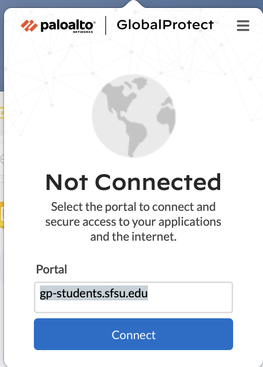
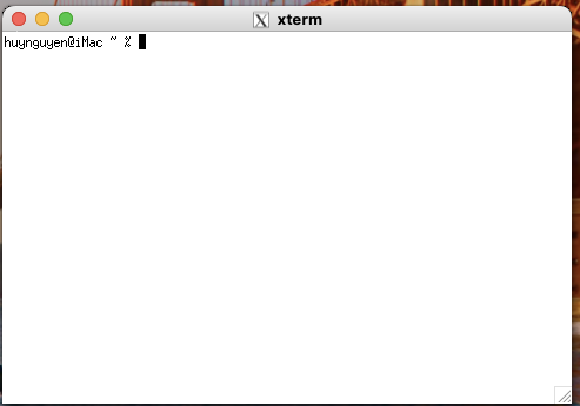

# Engineering lab notebook

## Session 01 — University laboratory access

**Record date:** 4 November 2026. Individual command timestamps were not captured. The last-login banner describes an earlier login and is not the timestamp of this session.

### 1. VPN connection

GlobalProtect initially displayed Not Connected with the student VPN portal populated. A subsequent screenshot displayed Connected and Best Available Gateway. This establishes the visible connection state at capture time; it does not measure VPN performance.




### 2. Local terminal

XQuartz xterm opened with a local iMac shell prompt. Pasting into xterm did not work during the guided session, so the workflow moved to the regular macOS Terminal. No terminal-preference repair was verified.



### 3. SSH login

Executed command, with account identifier redacted:

```sh
ssh -X <student-id>@mahmoodi.rcc.at.sfsu.edu
```

SSH presented a first-use ED25519 host-key prompt. The response was `yes`, and SSH recorded the host key. The transcript does not establish independent fingerprint verification. Authentication then completed and a university shell prompt appeared.

Observed messages are retained in the [login transcript](../evidence/transcripts/01-ssh-login.txt): a post-quantum key-exchange warning, a web-console announcement, and an xauth message about a missing .Xauthority file. Login succeeded despite these messages. No server upgrade, cockpit activation or xauth repair is claimed.

### 4. Remote status

Executed:

```sh
pwd; ls; echo "DISPLAY=$DISPLAY"
```

Observed:

```text
/home/<student-id>

DISPLAY=localhost:12.0
```

The prompt and home path establish the remote account context. No ordinary directory entries were printed by `ls`. The forwarding display was assigned, but an actual graphical-window test is still pending.

### Acceptance checkpoint

Completed: VPN connection shown; local xterm opened; remote login completed; working directory and DISPLAY checked.

Pending: shell/tool environment checks, hidden-file listing, remote window test and project execution. No RTL results or physical measurements have been produced in this recorded session.
