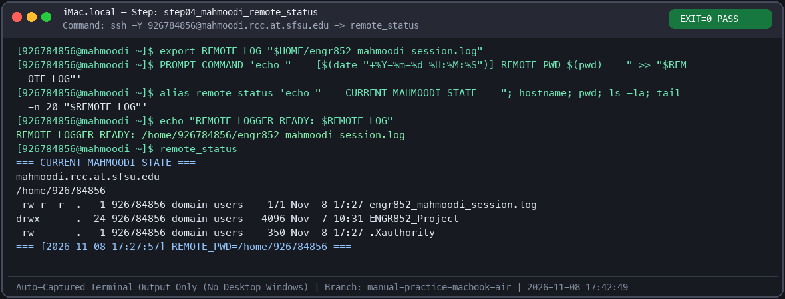
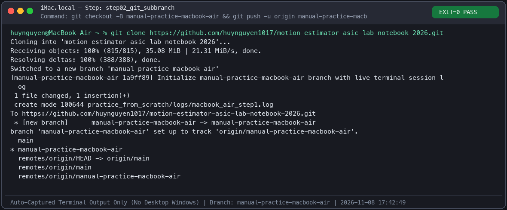

# Live Practice Telemetry (`manual-practice-macbook-air`)

> **Sub-Branch Isolation**: All hands-on practice terminal logs and auto-captured terminal-only screenshots are pushed exclusively to `manual-practice-macbook-air`, keeping `main` untouched.

## Completed Practice Steps (Auto-Captured Terminal Logs & Screenshots)

| Step | Host / Terminal | Status | Terminal Output Log | Auto-Captured Terminal Screenshot |
| :--- | :--- | :--- | :--- | :--- |
| **Step 01** | `huynguyen@MacBook-Air` | `EXIT=0 PASS` | [`step01_macbook_logger.log`](logs/step01_macbook_logger.log) | [`step01_macbook_logger_terminal.png`](screenshots/step01_macbook_logger_terminal.png) |
| **Step 02** | `huynguyen@MacBook-Air` | `EXIT=0 PASS` | [`step02_git_subbranch.log`](logs/step02_git_subbranch.log) | [`step02_git_subbranch_terminal.png`](screenshots/step02_git_subbranch_terminal.png) |
| **Step 03** | `huynguyen@MacBook-Air` | `EXIT=0 PASS` | [`step03_ssh_config_xquartz.log`](logs/step03_ssh_config_xquartz.log) | [`step03_ssh_config_xquartz_terminal.png`](screenshots/step03_ssh_config_xquartz_terminal.png) |
| **Step 04** | `926784856@mahmoodi` | `EXIT=0 PASS` | [`step04_mahmoodi_remote_status.log`](logs/step04_mahmoodi_remote_status.log) | [`step04_mahmoodi_remote_status_terminal.png`](screenshots/step04_mahmoodi_remote_status_terminal.png) |

---

### Step 04 — Live `mahmoodi` Session Verification (`[926784856@mahmoodi ~]$`)

### Step 02 — GitHub Sub-Branch Initialization (`manual-practice-macbook-air`)

