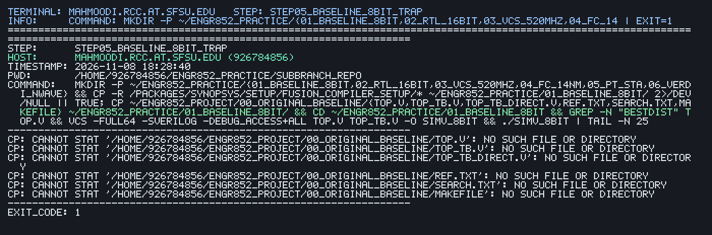

# Live Practice Telemetry (`manual-practice-macbook-air`)

- **Latest Step Executed**: `step05_baseline_8bit_trap`
- **Timestamp**: `2026-11-08 18:50:50 PST`
- **Host / Account**: `926784856@mahmoodi.rcc.at.sfsu.edu`
- **Working Directory**: `/home/926784856/motion-estimator-asic-lab-notebook-2026`
- **Command Executed**:
```bash
mkdir -p ~/engr852_practice/01_baseline_8bit && cp -f ~/ENGR852_Project/00_original_baseline/{top.v,top_tb.v,top_tb_direct.v,ref.txt,search.txt,Makefile} ~/engr852_practice/01_baseline_8bit/ && cd ~/engr852_practice/01_baseline_8bit && grep -n 'BestDist' top.v && vcs -full64 -sverilog -debug_access+all top.v top_tb.v -o simv_8bit && ./simv_8bit | tail -n 25
```
- **Exit Code**: `127`
- **Terminal Log**: [`practice_from_scratch/logs/step05_baseline_8bit_trap.log`](logs/step05_baseline_8bit_trap.log)
- **Auto-Captured Terminal Screenshot**:


